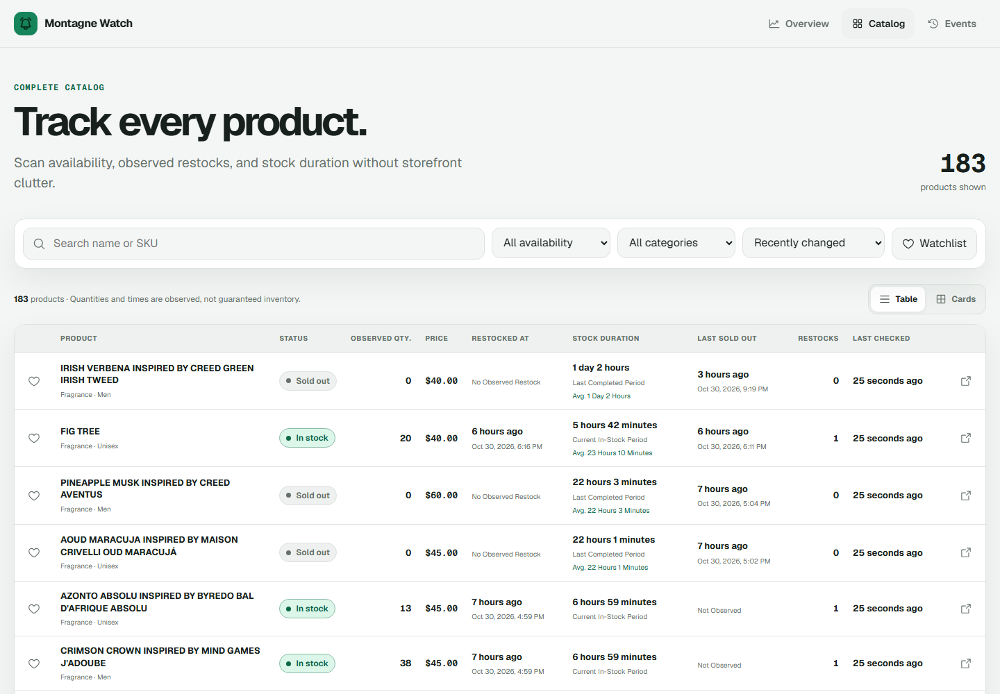

# Montagne Watch

A public, data-dense stock dashboard for tracking the Montagne Parfums catalog. It records observed restocks, sellouts, availability periods, quantities, and price changes without presenting the catalog like a traditional storefront.

**Live demo:** https://montagne-watch.vercel.app



## What it tracks

- Current availability across the full catalog
- Observed quantity and last successful check
- Restock and sold-out events
- Current, previous, and average in-stock durations
- Price changes, new products, and removals
- Product-level event and availability history
- Browser-local watchlists without user accounts

On desktop, the catalog uses a sortable operational table. On mobile, every row becomes a compact information panel so all fields remain readable without horizontal scrolling.

## Architecture

```text
Montagne catalog HTML
        ↓
Python monitor (persistent polling)
        ↓
SQLite event + availability history
        ↓
Token-protected read API
        ↓
Next.js server-side proxy
        ↓
Public Vercel dashboard
```

The monitor runs separately from Vercel because continuous polling and durable state do not belong inside request-oriented serverless functions. The browser never receives the backend API token.

## Reliability choices

- The first run creates a silent baseline instead of generating false restock events.
- Failed, blocked, or incomplete catalog responses preserve the last known state.
- Individual product pages provide quantity enrichment without creating fake restocks.
- Quantity is labeled **observed quantity** because it is a snapshot, not guaranteed warehouse inventory.
- Availability statistics only become authoritative after monitoring has observed real transitions.

## Local development

### Requirements

- Node.js 20+
- Python 3.11+

### Configure

```bash
cp .env.example .env
```

Generate a long random token and use the same value for `MONTAGNE_API_TOKEN` and `MONTAGNE_BACKEND_TOKEN`.

### Start the monitor and API

```bash
python monitor/run.py
```

### Start the dashboard

```bash
npm install
npm run dev
```

Open `http://localhost:3000`.

## Verification

```bash
# Frontend
npm test
npm run lint
npm run build

# Monitor and API
cd monitor
PYTHONPATH=. python -m unittest discover -s tests -v
```

## Main technologies

- Next.js, React, TypeScript
- Python standard library HTTP service
- SQLite with WAL mode
- Vitest and Python `unittest`
- Vercel for the public dashboard
- PM2 and Caddy for the persistent monitor/API deployment

## Disclaimer

This is an independent tracking project and is not affiliated with or endorsed by Montagne Parfums. Availability, quantity, and price data may change between checks and should be verified on the retailer's website before purchasing.

## License

MIT
